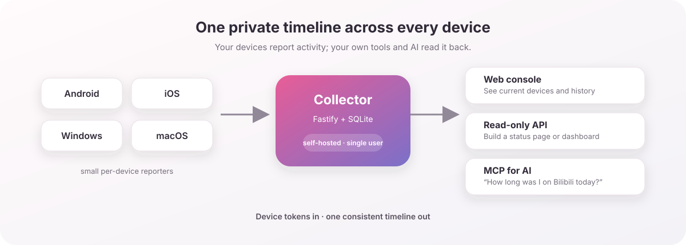

<div align="center">


[](https://github.com/asashiki)

</div>

# device-timeline-mcp

> [English](README.md) | **中文**

**随时查看每台设备正在用什么应用，也可以让 AI 回答“我今天把时间花到哪里了”。**

这是一个自托管、单用户的活动时间线：把 **Android、iOS、Windows、macOS** 的使用记录统一存进 SQLite，并通过三种方式读取：

- 一个**只读 HTTP API**（给你自己的状态页 / 前端用）；
- 一个**网页控制台**，用来直接看数据；
- 一个 **MCP 服务器**，让 AI 助手（Claude Desktop、Claude Code…）回答"他现在在干嘛？" / "今天在 B站 花了多久？"。

没有账号系统：只需运行一个收集器，再给每台设备分配自己的 token。

---

## 它是怎么连起来的



**收集器**跑在服务器上（Docker）。**MCP 服务器**是个很薄的 stdio 进程，跑在你 AI 客户端所在的机器上，它只是去调收集器的只读 API。

---

## 快速开始（Docker）

```bash
git clone https://github.com/asashiki/device-timeline-mcp.git
cd device-timeline-mcp
node tools/init-config.mjs

docker compose up -d --build
```

打开 `http://<host>:4823/console` —— 设备开始上报后就会一台台出现。健康检查：`curl http://<host>:4823/health`。

### 不用 Docker（Node ≥ 22.13）

```bash
npm ci
node tools/init-config.mjs
npm run build && npm start      # 或：npm run dev
```

> **为什么要 Node 22.13+？** 收集器用的是 Node 自带的 `node:sqlite`，不需要编译任何原生模块。

---

只有 Docker 的主机也可以在仓库目录运行 `docker run --rm --user "$(id -u):$(id -g)" -v "$PWD:/src" -w /src node:24-bookworm-slim node tools/init-config.mjs` 完成初始配置。

## 身体状态与每日记录

第一次运行 `node tools/init-config.mjs` 会生成各设备的 token，保存在 `config/device-tokens.json`，只读凭据位于 `private/`。再次运行会保留原有文件。在各采集端填入对应的设备 token。通过反向代理使用网页时，将 `HIBI_CONSOLE_ORIGIN` 设为实际的 HTTPS 网站地址。

`GET /api/agent/body-now` 返回最近心率、已有步数、上次睡眠及当前睡醒判断，并标注采样时间。身体只读凭据可查这些数据。使用综合只读凭据还能查各设备最近状态，以及 Mac 能提供的桌面和窗口信息。`GET /api/agent/body-range?from=…&to=…` 可查最多七天的已结束时段。手环报告入睡或近期数据符合睡眠规律时显示「睡了」，其余时间默认显示「醒着」。页面另列手环数据时间。

可选的 Notion 接入支持按需刷新私有状态页。每日记录页按小时展开应用和身体记录，迟到的数据会补回发生的日期。安装步骤见 [Notion 与日报说明](scripts/README.md)。

## 三步上手

1. **起收集器**：照上面 Docker 那段跑起来，确认 `/console` 能打开。
2. 从 `config/device-tokens.json` 取出该设备对应的 token，填入采集端。
3. **装采集端**：去 [`reporters/`](reporters/) 对应平台的目录，填上**服务器地址**和这台设备的 **token**，剩下的它自己上报。

---

## 设备 token 与多设备命名

每台设备用自己的 token 认证。在 `.env` 的 `DEVICE_TOKENS_JSON` 里定义（也可以用 `DEVICE_TOKENS_FILE` 指向一个 JSON 文件）。

```jsonc
[
  {"token":"<openssl rand -hex 32>","deviceId":"android-phone","deviceName":"我的手机","platform":"android"},
  {"token":"<openssl rand -hex 32>","deviceId":"android-tablet","deviceName":"平板 Y700","platform":"android"},
  {"token":"<openssl rand -hex 32>","deviceId":"windows-pc","deviceName":"台式机","platform":"windows"},
  {"token":"<openssl rand -hex 32>","deviceId":"mac-laptop","deviceName":"MacBook","platform":"macos"},
  {"token":"<openssl rand -hex 32>","deviceId":"ios-phone","deviceName":"iPhone","platform":"ios"}
]
```

**"同平台两台设备"的关键点**：设备靠 **`deviceId`** 区分，而*不是*靠平台。如果你有一台 Android **手机**和一台 Android **平板**，给它们**不同的 `deviceId`**（比如 `android-phone` 和 `android-tablet`），各配**各自的 token**。两台都是 `platform: "android"`，都落进同一批表；查询时都能按 `deviceId` 过滤，控制台里也分成两张卡片。

- `deviceId`：kebab-case、唯一、稳定。它是连接键，**之后别改**。
- `deviceName`：随便写的显示名（控制台 / MCP 输出里展示）。
- 每个 token 用 `openssl rand -hex 32` 生成。

---

## 各平台采集端安装

采集端都在 [`reporters/`](reporters/)，每个都有自己的 README：

| 平台 | 源码 | 说明 |
|---|---|---|
| Android | [`reporters/android`](reporters/android) | 前台应用记录、可选健康连接与已配对手环采集 |
| Windows | [`reporters/windows`](reporters/windows) | .NET 托盘程序，单文件 exe |
| macOS | [原生客户端](reporters/macos-native) 或 [Python 采集端](reporters/macos) | 前台应用，原生版可上报电量和窗口状态 |
| iOS | [`reporters/ios`](reporters/ios) | 快捷指令自动化（没有可安装的 app） |

每个采集端使用自己的服务器地址与设备 token。安卓按前台切换事件和周期采样记录，Mac 原生版还会上报电量。iPhone 使用所选 App 的快捷指令事件。

### Android（手机 / 平板）

从 [`reporters/android`](reporters/android) 编译 APK（Android Studio 或 Android 目录说明中的 Gradle 命令），然后：

1. 把 APK 装到设备上。
2. 打开一次 → 授予**使用情况访问**权限（设置 → 应用 → 特殊权限 → 使用情况访问），并为它**关闭电池优化**（让它后台一直上报）。
3. 在 app 设置里填：
   - **服务器地址**：`https://<your-host>`（或局域网 `http://host:4823`）
   - **Token**：这台设备的 token
4. **手机 + 平板**的话，两台都装，手机填**手机的 token**、平板填**平板的 token**。区别就这一点。

> **后台留存**：Android 采集端用了前台服务（Android 14+ 用 `specialUse` 类型，绕开 dataSync 在 Android 15 上的 6 小时/24 小时运行上限）、`WAKE_LOCK`、`START_STICKY`、`onTaskRemoved` 重新拉起、开机自启（BootReceiver），外加**两层看门狗**：AlarmManager `setAlarmClock`（绕过 Doze 和 MIUI/HyperOS 限制）作为主恢复路径，WorkManager 周期任务（每 ~15 分钟）作为兜底。

### iOS —— 快捷指令自动化

iOS 没有后台采集端，靠 **快捷指令** app 里两个**个人自动化**来驱动。

**A. "打开 App" 自动化**（打开任意被追踪的 app 时触发）：

- 新建自动化 → **App** → 选要追踪的 app → **已打开**。
- 动作：**获取 URL 内容** → `POST https://<host>/api/devices/ios/app-event`，请求头 `Authorization: Bearer <ios token>`，JSON body `{"app":"<App 名>","action":"open"}`。
- **关掉**"运行前询问"。


**B. "关闭 App" 自动化** —— 同上，把 `action` 设成 `close`。


完整快捷指令走法和 body 格式见 [`reporters/ios`](reporters/ios)。

### Windows

1. 把采集端 `.exe` 放到机器上（单文件、自包含）。
2. 第一次运行 → 托盘图标 → **设置**：
   - **服务器地址**：`https://<host>`
   - **Token**：`windows-pc` 的 token
3. 勾上**开机启动**（写一条 `HKCU\…\Run` 注册表）。

### macOS

1. `pip3 install -r requirements.txt`。
2. 给运行它的终端/程序授予**辅助功能**权限（系统设置 → 隐私与安全性 → 辅助功能）—— 读窗口标题需要。
3. 编辑 `config.json` → 填 `serverUrl` + `token`（`mac-laptop` 的 token）。
4. 装成 launchd 守护进程自启（见 `reporters/macos`）。

---

## 接入 MCP 客户端

有两种接法，取决于你的 AI 客户端是本地跑 MCP（stdio）还是连一个远程 URL（HTTP）。

### A. 本地客户端 —— stdio（Claude Desktop、Claude Code）

在你客户端所在的机器上跑自带的 stdio MCP 服务器，指向收集器：

```jsonc
// Claude Desktop: claude_desktop_config.json
{
  "mcpServers": {
    "device-timeline": {
      "command": "node",
      "args": ["/abs/path/device-timeline-mcp/dist/mcp/server.js"],
      "env": { "MCP_API_BASE": "https://<your-host>" }
    }
  }
}
```

### B. 远程客户端 —— HTTP / `/mcp`（claude.ai 网页版）

收集器还内置了一个 **streamable-HTTP 的 MCP 端点**，挂在 `/mcp`（同一个服务、同一个端口，不用额外进程）。**claude.ai** 这类网页客户端没法用 stdio，只能连 URL。把客户端的「自定义 / 远程 MCP 连接器」指向：

```
https://<你的域名>/mcp
```

- **域名你自己准备**：用任意反向代理 / 隐道把收集器套上 HTTPS，再在客户端里加这个远程连接器。
- claude.ai **只认 HTTPS** —— 纯 `http://IP:端口` 不行，所以必须走反代上 HTTPS。
- 该端点**默认不鉴权**（它暴露的是你自己的活动数据）。要么只放在你自己能访问的地方，要么设 `MCP_HTTP_TOKEN`，强制带 `Authorization: Bearer <token>`。想彻底关掉就设 `MCP_HTTP_ENABLED=false`。

暴露的工具（两种传输方式一致）：

| 工具 | 回答什么 |
|---|---|
| `device_status` | 每台设备此刻在干嘛（在线、前台应用、电量） |
| `device_timeline` | 某一天的时间顺序活动（可按 `deviceId` 过滤） |
| `device_activity_summary` | 某一天每个应用的使用时长汇总 |

---

## 只读 API（给你自己的前端）

已开启 CORS（`CORS_ORIGIN`，默认 `*`）。所有时间戳是 **UTC ISO**；`date=` 指 `DISPLAY_TZ`（默认 `Asia/Shanghai`）下的某个日历日。

| 端点 | 用途 |
|---|---|
| `GET /health` | 存活检查 + schema 版本 |
| `GET /api/devices/current` | 每台设备最新状态（含 `appName`、`live` 文案） |
| `GET /api/devices/timeline-query?date=&deviceId=&limit=` | 活动列表 |
| `GET /api/devices/activity-summary?date=&deviceId=` | 每个应用的时长汇总 |
| `GET /api/app-labels` | 原始的 appId → {name, desc} 映射 |
| `GET /api/devices/health/summary?hours=&deviceId=` | 健康数据汇总（每类指标 sum/min/max/avg + 最新值） |
| `GET /api/devices/health/records?type=&hours=&deviceId=&limit=` | 某类健康指标的原始样本（倒序） |
| `POST /api/devices/report` | **上报入口**（Android/桌面采集端，Bearer token） |
| `POST /api/devices/ios/app-event` | **上报** iOS 开/关（Bearer token） |
| `POST /api/devices/ios/snapshot` | **上报** iOS 电量/专注快照（Bearer token） |
| `POST /api/devices/health` | **上报** Health Connect 健康样本（Bearer token，`{records:[…]}`） |

`current` / `timeline` 的响应里带了服务端算好的 `appName` 和 `live`（一句自然语言），前端不用自己重写标签逻辑。`/console` 页面就是个现成示例。

---

## 自定义应用名

`config/app-labels.json` 把 `appId`（Android 包名、Windows 进程名、macOS bundle id、或 iOS 应用名）映射到友好名字 + 状态短语：

```json
{ "tv.danmaku.bili": { "name": "哔哩哔哩", "desc": "正在刷 B站~" } }
```

改完**保存**即可 —— 收集器会**热重载**（不用重启、不用重新构建），因为它从挂载卷（`./config`）读。未知应用回退成路径最后一段首字母大写。

---

## 数据模型

两张表（见 `src/db/migrations.ts`），用 `PRAGMA user_version` 做版本化迁移。

- **`device_states`** —— 每台设备一行：当前前台应用、最后上报时间、`extra` JSON。
- **`device_activities`** —— 追加式的"同一应用、时间连续"的活动段（相邻采样若在 `ACTIVITY_GRACE_SECONDS` 内会合并成一行）。

SQLite 文件落在 `./data` 卷上。

## 数据保留（自动清理）

活动历史会自动清理，DB 不会无限膨胀。收集器在启动时、以及之后每 24 小时，会删除 `device_activities` 里超过 `RETENTION_DAYS` 天的记录（默认 **60** 天，约两个月）。`device_states`（每台设备一行）不清理。设 `RETENTION_DAYS=0` 可关闭清理、全部保留。

## 备份

备份**故意交给你自己**——每个人需求不一样（备到另一台 VPS、推到远程数据库、对象存储等），所以收集器不内置任何备份方案。DB 就是 `./data` 卷上的单个文件，最简单就是复制它；运行中想要一致快照，用 `sqlite3 <db> '.backup <目标>'` 或 `VACUUM INTO <目标>`。

## 许可证

服务端和桌面采集端使用 [MIT](LICENSE)。包含 HealthAPP 协议代码的安卓应用按 [AGPL-3.0](reporters/android/healthapp-core/src/main/assets/healthapp/LICENSE-AGPL-3.0.txt) 发布。见[上游说明](reporters/android/healthapp-core/UPSTREAM.md)。

---

<div align="center">
<sub>Asashiki 项目集的一员 · 视觉语言见 <a href="https://github.com/asashiki/asashiki-design">Asashiki Design</a> · 墨と桜。</sub>
</div>
